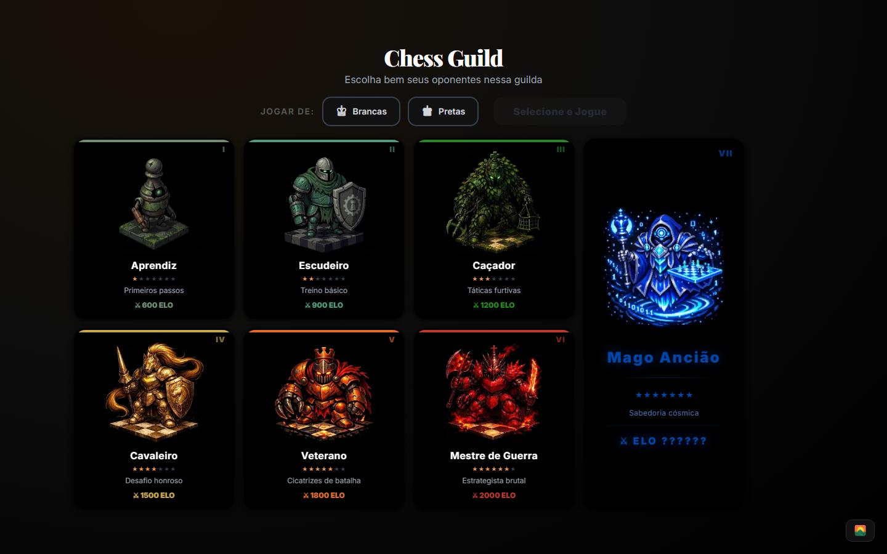
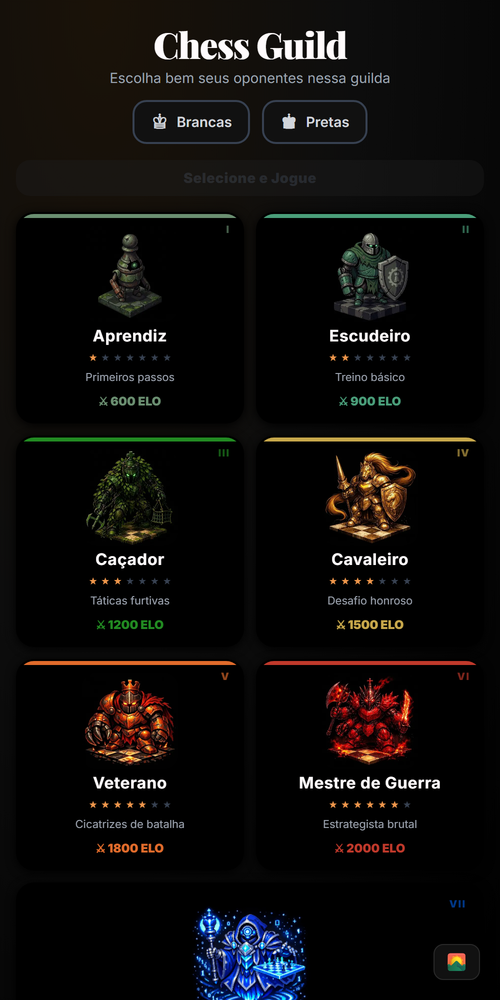
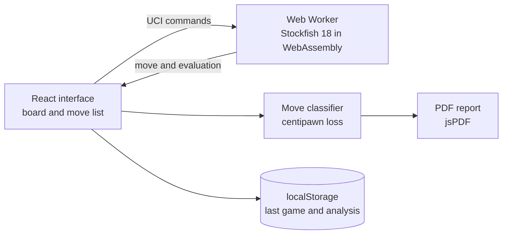

# Chess Guild

A chess platform that runs entirely in the browser: you play against 7 bots, from beginner to master, and after each game you get an analysis of every move, with an advantage graph and a PDF report.

**Live:** https://chessguild.vercel.app · [Leia em português](README.md)

<p align="center">
  
  
</p>

## What it does

- **7 bots of different strengths:** from the Apprentice (Aprendiz), with an estimated rating of 600, to the Ancient Mage (Mago Ancião), with 2400. Each one uses a Stockfish strength level.
- **Move-by-move analysis:** after the game, the engine evaluates every position and classifies each move by how much advantage it lost, from Brilliant to Blunder.
- **Accuracy and advantage graph:** the percentage of good moves and how the advantage shifted throughout the game.
- **PDF report:** exports the game, the graph and the accuracy, generated in the browser itself.
- **No back end:** there is no server and no login. The last game and its analysis are saved only in the browser.

## Stack

| Layer | Technology |
|---|---|
| Application | Next.js 16 (App Router), React 19, TypeScript |
| Interface | Tailwind CSS 4, shadcn/ui |
| Chess | chess.js (rules), react-chessboard (board), Stockfish 18 in WebAssembly (engine) |
| Report | jsPDF |
| Hosting | Vercel |

## How it works



Three decisions behind the design:

- **The engine runs in the browser.** Stockfish 18, compiled to WebAssembly, runs in a Web Worker, off the interface thread, and talks to it through the UCI protocol. With no server, hosting costs nothing and the game never waits on the network.
- **Bot strength comes from Stockfish itself.** Each bot turns on `UCI_LimitStrength` and uses a `Skill Level` from 0 to 20, with 500 ms to think about each move. The rating shown is an estimate.
- **Classification measures centipawn loss.** Each move is compared with the position's evaluation before and after it. A centipawn is one hundredth of a pawn.

| Bot | Skill Level | Estimated rating |
|---|---|---|
| Apprentice (Aprendiz) | 0 | 600 |
| Squire (Escudeiro) | 3 | 900 |
| Hunter (Caçador) | 6 | 1200 |
| Knight (Cavaleiro) | 10 | 1500 |
| Veteran (Veterano) | 14 | 1800 |
| Warmaster (Mestre de Guerra) | 17 | 2000 |
| Ancient Mage (Mago Ancião) | 20 | 2400 |

| Classification | Advantage lost on the move |
|---|---|
| Brilliant (Brilhante) | less than 20 centipawns, with a piece sacrifice |
| Excellent (Excelente) | less than 20 centipawns |
| Good (Boa) | 20 to 50 centipawns |
| Inaccuracy (Imprecisão) | 50 to 100 centipawns |
| Mistake (Erro) | 100 to 200 centipawns |
| Blunder (Capivarada) | 200 centipawns or more |
| Missed Win (Chance Perdida) | had an advantage of +3.0 or more and dropped below +1.0 |

Accuracy is the percentage of Brilliant, Excellent and Good moves.

The interface is in Portuguese; the names in parentheses are the ones you will see in the app.

## Running locally

The app lives in the `frontend` folder. You need Node.js 20.9 or newer. There is no database and there are no environment variables.

```bash
git clone https://github.com/EduardoFedeli/Chess-Guild.git
cd Chess-Guild/frontend
npm install
npm run dev   # http://localhost:3000
```

## Author

Built by **Eduardo Fedeli** ([GitHub](https://github.com/EduardoFedeli) · [LinkedIn](https://www.linkedin.com/in/eduardofedeli)).
