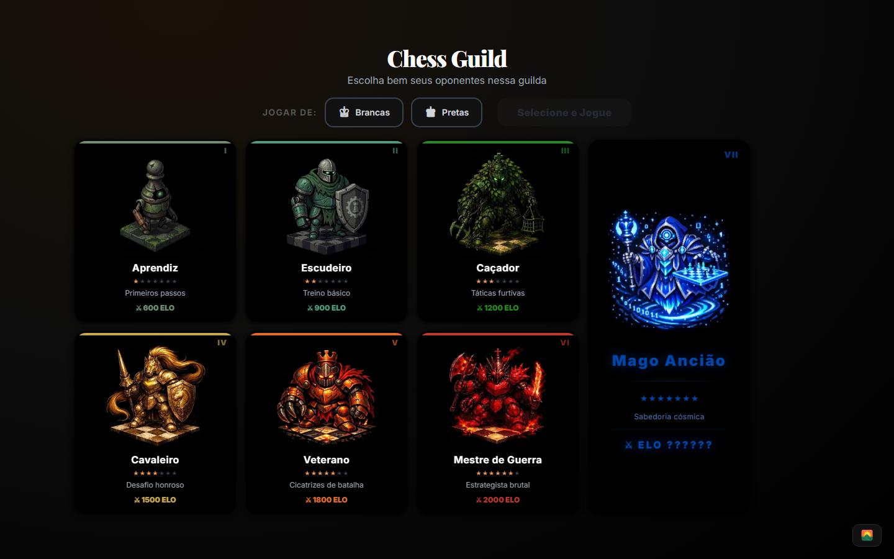
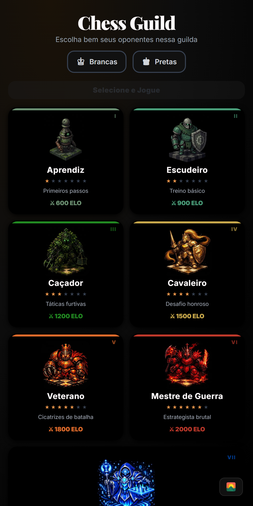
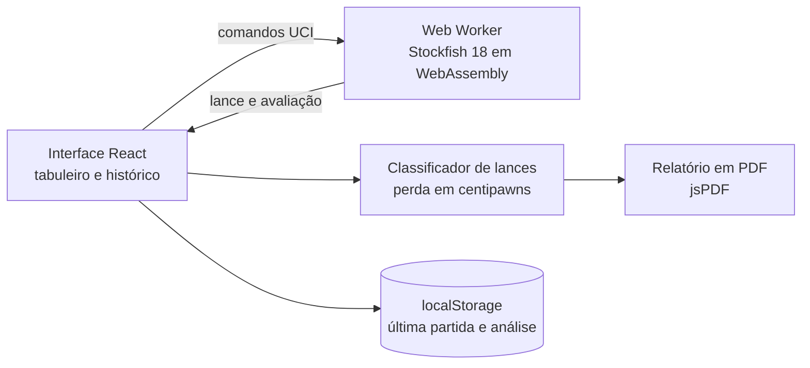

# Chess Guild

Plataforma de xadrez que roda inteira no navegador: você enfrenta 7 bots, do iniciante ao mestre, e depois de cada partida recebe a análise de todas as jogadas, com gráfico de vantagem e relatório em PDF.

**No ar:** https://chessguild.vercel.app · [Read in English](README.en.md)

<p align="center">
  
  
</p>

## O que ele faz

- **7 bots com forças diferentes:** do Aprendiz, com rating estimado de 600, ao Mago Ancião, com 2400. Cada um usa um nível de força do Stockfish.
- **Análise de cada jogada:** depois da partida, a engine avalia todas as posições e classifica cada lance pela perda de vantagem, de Brilhante a Capivarada.
- **Precisão e gráfico de vantagem:** a porcentagem de lances bons e a evolução da vantagem ao longo da partida.
- **Relatório em PDF:** exporta a partida, o gráfico e a precisão, gerado no próprio navegador.
- **Sem back-end:** não há servidor nem login. A última partida e a análise ficam salvas só no navegador.

## Stack

| Camada | Tecnologia |
|---|---|
| Aplicação | Next.js 16 (App Router), React 19, TypeScript |
| Interface | Tailwind CSS 4, shadcn/ui |
| Xadrez | chess.js (regras), react-chessboard (tabuleiro), Stockfish 18 em WebAssembly (engine) |
| Relatório | jsPDF |
| Hospedagem | Vercel |

## Como funciona por dentro



Três decisões que explicam o desenho:

- **A engine roda no navegador.** O Stockfish 18, compilado para WebAssembly, roda num Web Worker, fora da thread da interface, e conversa com ela pelo protocolo UCI. Sem servidor, a hospedagem não custa nada e a partida não espera a rede.
- **A força dos bots vem do próprio Stockfish.** Cada bot liga o `UCI_LimitStrength` e usa um `Skill Level` de 0 a 20, com 500 ms para pensar em cada lance. O rating mostrado é uma estimativa.
- **A classificação mede a perda em centipawns.** Cada lance é comparado com a avaliação da posição antes e depois dele. Um centipawn é um centésimo de peão.

| Bot | Skill Level | Rating estimado |
|---|---|---|
| Aprendiz | 0 | 600 |
| Escudeiro | 3 | 900 |
| Caçador | 6 | 1200 |
| Cavaleiro | 10 | 1500 |
| Veterano | 14 | 1800 |
| Mestre de Guerra | 17 | 2000 |
| Mago Ancião | 20 | 2400 |

| Classificação | Perda de vantagem no lance |
|---|---|
| Brilhante | menos de 20 centipawns, com sacrifício de peça |
| Excelente | menos de 20 centipawns |
| Boa | de 20 a 50 centipawns |
| Imprecisão | de 50 a 100 centipawns |
| Erro | de 100 a 200 centipawns |
| Capivarada | 200 centipawns ou mais |
| Chance Perdida | tinha vantagem de +3,0 ou mais e caiu para menos de +1,0 |

A precisão é a porcentagem de lances Brilhantes, Excelentes e Bons.

## Como rodar

O app fica na pasta `frontend`. Você precisa de Node.js 20.9 ou mais novo. Não há banco de dados nem variáveis de ambiente.

```bash
git clone https://github.com/EduardoFedeli/Chess-Guild.git
cd Chess-Guild/frontend
npm install
npm run dev   # http://localhost:3000
```

## Autor

Desenvolvido por **Eduardo Fedeli** ([GitHub](https://github.com/EduardoFedeli) · [LinkedIn](https://www.linkedin.com/in/eduardofedeli)).
